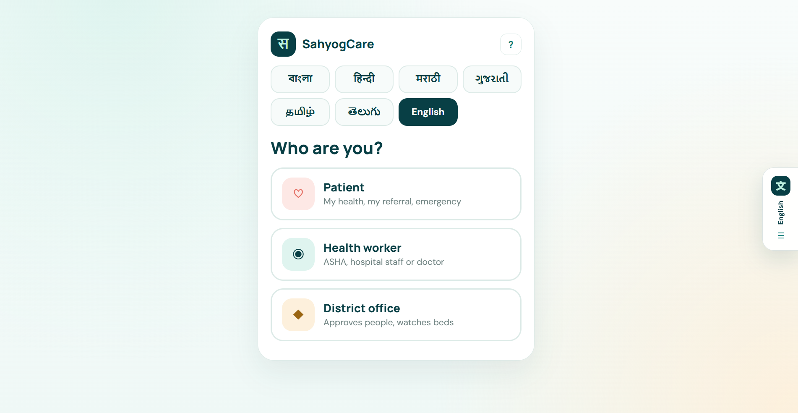
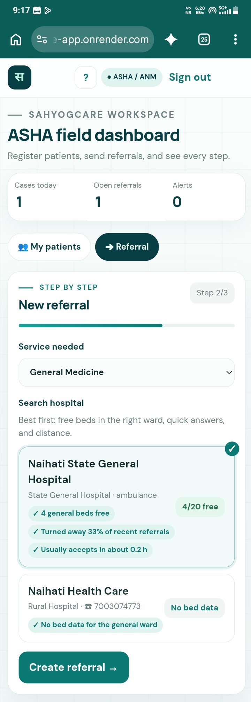
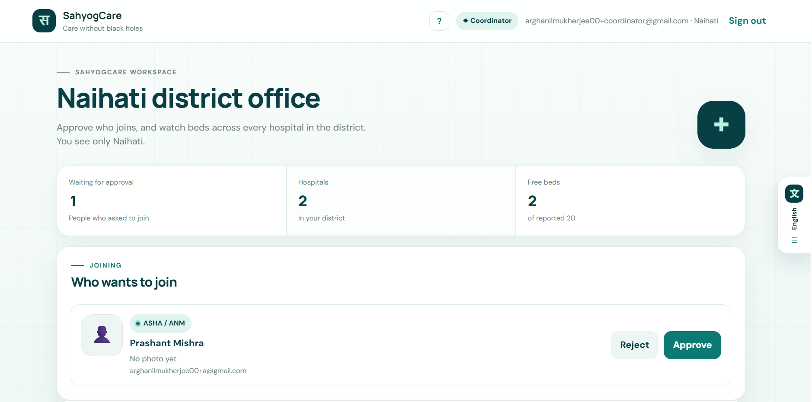
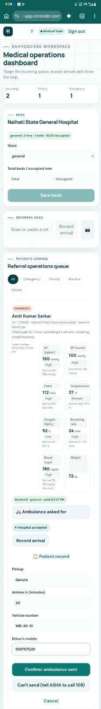
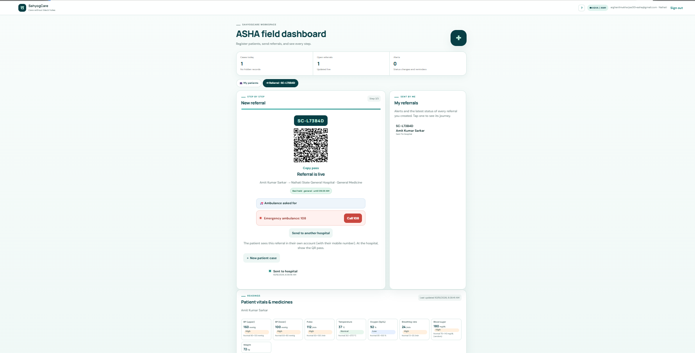
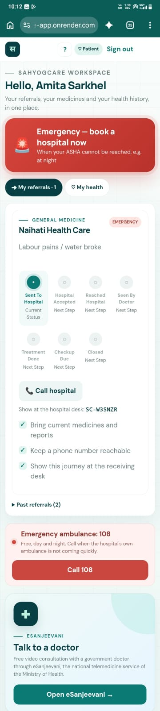
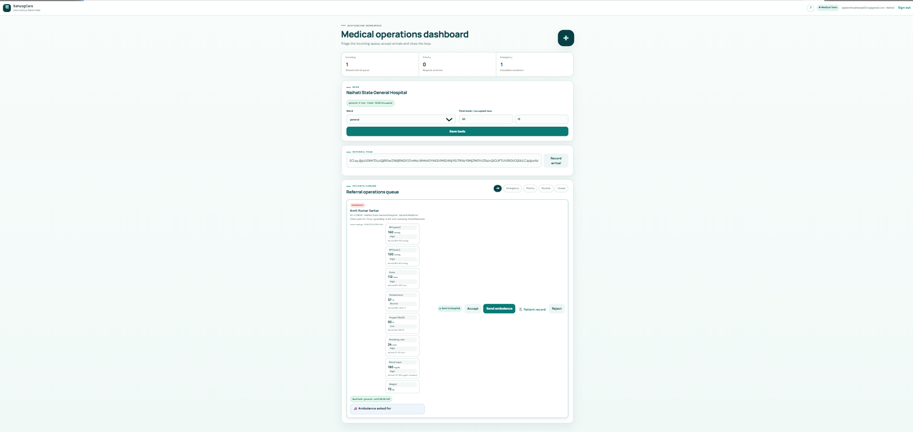

# SahyogCare

> Closed-loop referral tracking for rural India: it follows every patient an ASHA refers, from the village to the hospital bed and back, and raises an alarm when a step goes silent.

[](https://sahyogcare-app.onrender.com)
[](https://github.com/Somtirtho-299007/SahyogCare-App)

| | Link |
|---|---|
| Frontend (live) | https://sahyogcare-app.onrender.com |
| Backend health check | https://sahyogcare-api.onrender.com/api/v1/health |
| Areas served | https://sahyogcare-api.onrender.com/api/v1/public/districts |

> **Free hosting:** the server sleeps after about 15 minutes without use. The first page load can take up to a minute; after that it is fast.

---

## ⚠️ Note for judges: start with the District Office (coordinator)

SahyogCare has **no public sign-up into a role**. Every ASHA, hospital staff member and doctor must be **approved by their district office** before they can see any patient data. So the coordinator account must exist first.

**Please log in to the Coordinator (District Office) dashboard first, then open the ASHA and Medical Team dashboards.**

1. Open the live site → choose **District office** → enter your email → type the 6-digit code from your inbox (check Spam).
2. The app asks for your name, the area and the **office passphrase**. Use one of these (case, spaces and dashes don't matter). It is asked **only once**; the coordinator dashboard for that area then opens.     | Area | District office passphrase |    |---|---|    | **Naihati** (start here) | `NAI-FJYC-G2DT-UKH2-CMM3` |    | Nadia | `NAD-62M5-QXB2-95EY-YVJ4` |: choose **Naihati** and enter the passphrase given in our **submission form** (it is kept out of this public repository on purpose). It is asked **only once**; the **Naihati coordinator dashboard** then opens.
3. The first time, the coordinator also sees a **personal code** (8 characters, `XXXX-XXXX`). Write it down: every later login is the email code **plus** this personal code.
4. In another browser (or a private window), choose **Health worker**, sign in with a **different email**, fill in **Ask to join** (name, area **Naihati**, role **ASHA**, optional photo) and send it.
5. Back on the coordinator dashboard, press **Approve** under **"Who wants to join"**.
6. The ASHA's screen opens and shows her own personal code once. She writes it down too.
7. Repeat steps 4 to 6 for **Hospital staff** and **Doctor**, choosing **Naihati State General Hospital**.

**Tip: one Gmail is enough.** Gmail delivers `yourname+asha@gmail.com`, `yourname+staff@gmail.com` and `yourname+doctor@gmail.com` to the same inbox, but SahyogCare treats each one as a separate person. Use one browser window per role, because one browser keeps one login at a time.

The full walk-through is in [Complete workflow](#complete-workflow-how-to-test-it) below.

---

## Preview

| Desktop | Mobile |
|---|---|
|  |  |
|  |  |
|  |  |
|  | |
---

## What It Does

When an ASHA sends a pregnant woman or a sick patient to hospital, the referral usually ends with a paper slip. Nobody confirms whether the patient reached the hospital, whether a bed was free, or what happened next. Published reviews of digital referral tools find the same gap: they rarely track receipt, outcome or follow-up.

SahyogCare closes that loop for the ASHA, the hospital, the district office and the family:
- Sending a referral holds a bed and can request the hospital's ambulance.
- The hospital accepts or rejects with a reason.
- Every step comes back to the ASHA.
- A watchdog alerts the ASHA, then the district office, whenever a step goes silent.

It coordinates existing systems (108, eSanjeevani) rather than replacing them.

---

## Features

**Access and privacy**
- **Approval before access:** new accounts see nothing until their district office approves them. Each approved person gets a permanent personal code as a second login factor.
- **Separate areas:** Nadia and Naihati are separate worlds. A coordinator, ASHA or hospital never sees another area's people, hospitals or patients; other areas' records return "not found".

**The referral loop**
- **Closed-loop referral:** created → accepted or rejected → arrived → consulted → outcome → follow-up → closed. Only the right role can make each move, in order, and every step is recorded.
- **Hospital recommendation:** hospitals are ranked by free beds in the right ward, how fresh that count is, distance, recent rejections and acceptance speed, and the app shows the reasons.
- **Bed hold:** sending a referral reserves a bed before the patient travels. Arrival turns it into an occupied bed; rejection or timeout releases it.
- **One-tap re-route:** a rejected or full referral moves to the next-best hospital with a new code. The old bed hold and ambulance are cancelled, and the old code still finds the new referral.
- **Hospital ambulance and 108 fallback:** the ASHA requests the receiving hospital's vehicle, and staff dispatch it with ETA, vehicle number and driver phone. If there is no vehicle, it is cancelled, or it is late, the app shows **Call 108**.
- **Silence watchdog:** every 5 minutes it checks for referrals not accepted, patients not arrived, ambulances not sent or late, and follow-ups overdue. It alerts the ASHA, then the district office.
- **Signed QR referral pass:** the hospital scans it at the desk, even offline. The server signature stops forgeries.

**Patient care**
- **Patient health record:** each patient has one record with vitals checks (LOW / NORMAL / HIGH), conditions, prescriptions with photos, and a medicine care chart.
- **Patient account:** a patient signs in with their registered mobile and sees every referral, their record and a night-emergency button. No referral code is needed.

**Working conditions**
- **Offline sync:** actions done without network are queued and sent once when signal returns.
- **eSanjeevani hand-off:** one tap opens the government teleconsultation service with a copyable patient summary.
- **Multilingual and mobile-first:** English, Bengali, Hindi, Marathi, Gujarati, Tamil and Telugu, plus a guided tour on every dashboard.

---

## Planning Docs

- [PRD](./docs/PRD.md)
- [Architecture](./docs/ARCHITECTURE.md)
- [API Spec](./docs/API_SPEC.md)
- [Roadmap](./docs/ROADMAP.md)
- [Requirements](./docs/REQUIREMENTS.md)
- [Workflow and backend logic](./docs/WORKFLOW.md)
- [Email relay setup](./docs/EMAIL_RELAY.md)

**Deviations from the plan**

| Planned (Ronin / Kenshi) | Built (Samurai) | Why |
|---|---|---|
| Pre-registered staff only | Anyone signs in with their own email, asks for a role, and the district office approves; each approved person gets a personal code | Real teams cannot wait for a developer to create accounts |
| One district | Several areas (Nadia, Naihati), fully separated | Several district offices can share one server |
| Facility search by service | Ranked recommendation with bed counts, bed holds and re-routing | The real question at the hospital door is "is there a bed?" |
| No transport | Hospital ambulance requests with 108 fallback | Transport is a major cause of delay |
| Public lookup with referral code + phone digits | Patient account with mobile login | A family often has several referrals; an account is also more private |
| Demo accounts on the live site | Demo data switched off in production (`SAHYOG_DEMO_DATA=false`) | Real hospitals from nadia.gov.in only, no fake data |

---

## Architecture

```text
Phone / laptop browser
└── React 18 + Vite  (Render static site: sahyogcare-app.onrender.com)
    ├── src/entry.jsx     sign-in doors, join request, personal code
    ├── src/main.jsx      Coordinator, ASHA, Medical Team, Patient dashboards
    ├── src/health.jsx    patient record, vitals, care chart, emergency
    └── src/api.js        fetch wrapper: tokens, refresh, errors
          │  HTTPS, JSON  /api/v1/...
          ▼
FastAPI  (Render web service: sahyogcare-api.onrender.com)
    ├── app/routers/      REST endpoints (auth, referrals, beds, ambulance, ...)
    ├── app/workflow.py   referral state machine, events, notifications
    ├── app/recommend.py  hospital ranking · app/beds.py bed holds
    ├── app/watchdog.py   background check every 5 minutes
    ├── app/access.py     role + area scope checks on every query
    └── migrations/       Alembic, run automatically on start
          │  SQLAlchemy 2
          ▼
PostgreSQL (Render)   ·   SQLite locally
          │
          ├── Brevo API → login codes by email
          └── Fast2SMS (optional) → SMS codes and family alerts
```

**Data flow.**
1. The React app calls the FastAPI backend with a short-lived JWT.
2. Every request checks both the role and the area. Out-of-scope records answer 404, so their existence is not revealed.
3. Each referral status change writes the new status, a `referral_events` row, an audit entry and a notification in one database transaction.
4. The watchdog reads open referrals every 5 minutes and creates alerts for anything that has gone silent.

---

## Tech Stack

| Layer | Technology | Why |
|---|---|---|
| Frontend | React 18 + Vite 5 | Fast, small bundle for low-end Android phones |
| Styling | Plain CSS, mobile-first | No framework weight; full control of layout |
| Backend | FastAPI (Python) | Typed request validation, automatic `/docs` |
| ORM / migrations | SQLAlchemy 2 + Alembic | Same models on SQLite (local) and PostgreSQL (production) |
| Database | PostgreSQL (Render) | Relational data with foreign keys and transactions |
| Auth | Email OTP + personal code, JWT (PyJWT) | No passwords to forget or share |
| Email | Brevo HTTP API (SMTP as fallback) | Render's free plan blocks SMTP ports |
| QR | `qrcode` + HMAC-signed payload | Pass can be checked offline, cannot be forged |
| Hosting | Render (static site + web service + PostgreSQL) | Free tier, deploy from GitHub |
| Tests | pytest (162 tests) | Runs on SQLite and PostgreSQL |

---

## Database Schema

Created by the migrations in [`backend/migrations/versions/`](./backend/migrations/versions/) (0001 to 0010). Key tables:

```sql
facilities        (id, name, type, district, address, pincode, phone, latitude, longitude,
                   has_ambulance, hfr_id, source, active)
facility_services (id, facility_id → facilities.id, service, availability, availability_updated_at,
                   learned_from_referral_id)
bed_wards         (id, facility_id → facilities.id, ward, total, occupied, updated_at, updated_by_id → users.id)

users             (id, email, phone, name, role, district, facility_id → facilities.id,
                   approved, is_active, code_hash, photo_id → photos.id)
access_requests   (id, user_id → users.id, requested_role, facility_id → facilities.id,
                   status, decided_by_id → users.id, decided_at)
otp_codes         (id, email, code_hash, expires_at, attempts, used_at)

patients          (id, health_id, name, age, sex, phone, email, language, consent_recorded_at,
                   created_by_id → users.id, deceased_at)
encounters        (id, patient_id → patients.id, created_by_id → users.id, kind, reason, triage,
                   systolic, diastolic, pulse, temperature_c, spo2, glucose_mg_dl, weight_kg, referral_id)
medicines         (id, encounter_id → encounters.id, name, dose, frequency)
conditions        (id, patient_id → patients.id, name, status)   condition_events (condition_id → conditions.id)
prescriptions     (id, patient_id → patients.id, referral_id → referrals.id, diagnosis, photo_id)
care_items        (id, patient_id → patients.id, prescription_id → prescriptions.id, name, dose,
                   timings, food, start_date, duration_days, status)

referrals         (id, code, status, triage, requested_service, reason, rejection_reason,
                   patient_id → patients.id, encounter_id → encounters.id, created_by_id → users.id,
                   destination_facility_id → facilities.id, rerouted_from_id → referrals.id)
referral_events   (id, referral_id → referrals.id, from_status, to_status, actor_id → users.id, source, at)
bed_holds         (id, referral_id → referrals.id UNIQUE, facility_id → facilities.id, ward, status, held_until)
ambulance_trips   (id, referral_id → referrals.id, facility_id → facilities.id, status, eta_minutes,
                   vehicle_number, driver_phone, picked_up_at)
follow_ups        (id, referral_id → referrals.id, assigned_to_id → users.id, due_at, status, sent_at)

notifications     (id, user_id → users.id, referral_id → referrals.id, kind, message, read_at)
idempotency_keys  (key, user_id → users.id, response)
audit_log         (id, actor_id, action, target_type, target_id, at)   -- IDs only, never names
photos            (id, owner_type, owner_id, content_type, uploaded_by_id → users.id)
```

**Relationships.**
- A facility has many services, wards and staff.
- A patient has many encounters, conditions, prescriptions, care items and referrals.
- A referral has many events and follow-ups, at most one bed hold, and can point back to the referral it was re-routed from.

---

## API Routes

All routes start with `/api/v1`. Interactive docs: `/docs` on the backend.

| Method | Route | Auth | Description |
|---|---|---|---|
| GET | `/health` | Public | Server and database status |
| GET | `/public/districts` | Public | Areas served |
| POST | `/auth/otp/request` | Public | Email a 6-digit login code (rate-limited) |
| POST | `/auth/otp/verify` | Public | Check the code → tokens, or ask for the personal code |
| POST | `/auth/code` | Public + code token | Personal code step → tokens |
| POST | `/auth/refresh` | Refresh token | New access token |
| GET | `/me` | Any user | Current user (and new personal code once) |
| POST | `/office/join` | Any user | First entry as an area's coordinator with the office passphrase (not needed for listed officer emails) |
| POST | `/access-requests` | Any user | Ask for a role (ASHA, staff, doctor) in an area |
| GET | `/access-requests` | Coordinator | Pending requests in my area |
| POST | `/access-requests/{id}/approve` · `/reject` | Coordinator | Decide a request |
| GET · PATCH | `/users` · `/users/{id}` | Coordinator | People in my area; switch someone off |
| POST | `/users/{id}/reset-code` | Coordinator | Issue a new personal code |
| GET · POST · PATCH | `/facilities` · `/facilities/{id}` | Logged in · Coordinator | List / add / edit hospitals in my area |
| PUT | `/facilities/{id}/beds/{ward}` | Staff (own) · Coordinator | Update total and occupied beds |
| GET | `/facilities/recommend` | ASHA | Ranked hospitals with reasons |
| GET · POST | `/patients` · `/patients/{id}/encounters` | ASHA | Register patients; record visits and vitals |
| GET | `/patients/{id}/record` | ASHA · Staff · Doctor | Full health record |
| POST | `/referrals` | ASHA | Create referral (holds a bed; `Idempotency-Key`) |
| GET | `/referrals` · `/referrals/{id}` | Scoped | My / my hospital's / my area's referrals with history |
| POST | `/referrals/{id}/accept` · `/reject` · `/arrival` | Hospital staff | Hospital decision and arrival |
| POST | `/referrals/{id}/consultation` · `/outcome` | Doctor | Consultation and outcome (+ follow-up) |
| GET · POST | `/referrals/{id}/alternatives` · `/reroute` | ASHA | Other hospitals; move the referral |
| POST | `/referrals/{id}/ambulance` · `/dispatch` · `/picked-up` · `/cancel` | ASHA · Staff | Ambulance request and trip |
| GET | `/referrals/{id}/pass` | ASHA | Signed QR referral pass |
| POST | `/referral-passes/verify` | Staff | Check a scanned pass (also offline scans) |
| GET · POST | `/follow-ups` · `/{id}/sent` · `/miss` · `/complete` | ASHA · Hospital | Follow-up checkups |
| POST | `/referrals/{id}/escalate` | Coordinator | Escalate an overdue follow-up |
| GET | `/notifications` · POST `/{id}/read` | Logged in | Alerts |
| GET | `/dashboard/summary` | Logged in | Same counts for every role; bottlenecks for the coordinator |
| POST | `/sync/batch` · GET `/sync/changes` | Logged in | Offline queue upload; changes since |
| POST | `/public/login/request` · `/verify` · `/choose` · `/signup` | Public | Patient sign-in with mobile |
| GET | `/public/me/referrals` · `/public/me/record` | Patient | Patient's own referrals and record |
| POST | `/public/emergency` | Patient | Night emergency: best hospital, bed hold, ambulance, alerts |

Every error returns `{"error": {"code", "message", "details", "request_id"}}` with the right HTTP status, never a stack trace. The full list is in [docs/API_SPEC.md](./docs/API_SPEC.md).

---

## Complete Workflow (how to test it)

Use one browser window per person. Each step feeds the next.

### 1. District Office (Coordinator, Naihati): **do this first**
1. **District office** → email → 6-digit code → area **Naihati** + office passphrase `NAI-FJYC-G2DT-UKH2-CMM3` (asked only once) → coordinator dashboard. Note the personal code shown the first time.
2. Hospitals: only Naihati hospitals appear. Open **Manage** and set the General ward to 20 total, 15 occupied: it shows **5 free**. Add the **Emergency** service and tick **has ambulance**.
3. Keep this window open to approve people in the next steps.

### 2. ASHA
1. New window → **Health worker** → a second email → code → **Ask to join** as **ASHA** in **Naihati** (name, optional photo). The screen says the request is waiting.
2. Coordinator window: **Approve** under "Who wants to join". The ASHA screen opens by itself within half a minute (or press **Check again**) and shows her **personal code** once; note it down.
3. Register a patient (name, age, mobile, consent) and record vitals; out-of-range readings are flagged.
4. Choose a service: hospitals appear **ranked with reasons**. Pick one → **Create referral →**. You get a code (`SC-XXXXXX`), a **QR pass** and **"Bed held for you"**.
5. **Ask hospital for ambulance** with a pickup note; **Call 108 (ambulance)** is always visible. The eSanjeevani card opens the government teleconsultation site, and **Copy patient summary for the doctor** copies the case.

### 3. Medical Team: Hospital staff
1. New window → **Health worker** → third email → **Ask to join** as **Hospital staff** at **Naihati State General Hospital** → coordinator approves → note the personal code.
2. The referral is in the queue, Emergency first, with vitals and "Bed held". The header shows the bed panel.
3. **Accept**, then **Send ambulance** (ETA, vehicle number, driver phone) → **Patient picked up** → **Record arrival**, or scan or paste the QR pass. The bed changes from held to occupied.
4. Reject a second test referral with **"No beds available"**: the ASHA gets an alert and can re-route.

### 4. Medical Team: Doctor
1. Sign out in the staff window → sign in with `yourname+doctor@gmail.com` → **Ask to join** as **Doctor** at the same hospital → coordinator approves.
2. **Mark consulted** → **Record outcome** with a follow-up in 7 days.

### 5. ASHA again
1. Alerts show every step: accepted, ambulance, arrived, outcome.
2. **Follow-up checkup due** appears with its date. Press **Patient sent for checkup** (the hospital is told to expect the patient) or **Couldn't go** (marked missed, the district office sees it).
3. Staff or doctor window: press **Checkup done**. Only the receiving hospital can confirm it, and the referral becomes **CLOSED**.
4. On the rejected referral: **Choose another hospital** → it moves with a new code; the old bed hold and ambulance are cancelled.

### 6. Patient
1. **Patient** → the mobile number the ASHA registered → code. Without SMS, the ASHA opens the patient's record and presses **Sign-in code for the patient** (works once, for 15 minutes).
2. The patient sees every referral, the journey, ambulance details and their care chart. **Call 108** and the emergency button are visible.

### 7. Coordinator again
- Dashboard counts match what happened, and late or silent referrals appear as alerts.
- - Separation check: sign in with another email as a **Nadia** coordinator (passphrase `NAD-62M5-QXB2-95EY-YVJ4`). It sees **none** of the Naihati data, and the Naihati coordinator sees none of Nadia's. sees **none** of the Naihati data.

```text
ASHA ──referral + bed hold──► Hospital staff ──accept──► arrival ──► Doctor ──outcome──► Follow-up ──► CLOSED
  ▲            │ reject / no bed                                                      │ missed
  │            └──► re-route to next-best hospital (new code, old hold released)      └──► OVERDUE ──► Coordinator escalates
  └──────────── alerts at every step · watchdog alerts on silence ──────────────► District office
```

---

## Getting Started (run locally)

```bash
git clone https://github.com/Somtirtho-299007/SahyogCare-App.git
cd SahyogCare-App
```

**Terminal 1: backend** (Python 3.11+; on Windows use `python -m pip`)

```bash
cd backend
python -m pip install -r requirements-dev.txt
cp .env.example .env          # Windows: copy .env.example .env
python -m app.seed            # demo hospitals and @sahyogcare.test accounts
python -m uvicorn app.main:app --reload
```

The API runs on http://127.0.0.1:8000, with docs at `/docs`. Migrations run automatically on start.

**Terminal 2: frontend**

```bash
npm install
npm run dev
```

Open http://localhost:5173. Vite forwards `/api` to the backend.

Locally, login codes appear **on screen** and in the backend terminal, so no email setup is needed. Demo accounts such as `coordinator@sahyogcare.test`, `asha@sahyogcare.test`, `staff@sahyogcare.test` and `doctor@sahyogcare.test` are already approved.

**Tests:** `cd backend && python -m pytest` runs 162 tests on a throwaway database.

---

## Environment Variables

Backend settings live in `backend/.env` (copy from [`backend/.env.example`](./backend/.env.example)). `.env` is in `.gitignore` and is never committed.

| Variable | Description | Where to get it |
|---|---|---|
| `SAHYOG_DATABASE_URL` | Database address; SQLite by default, PostgreSQL in production | Render → PostgreSQL → Internal Database URL |
| `SAHYOG_SECRET_KEY` | Signs tokens, codes and QR passes (32+ random characters) | `python -c "import secrets; print(secrets.token_urlsafe(48))"` (Render generates it) |
| `SAHYOG_ENVIRONMENT` | `development` or `production` (production hides on-screen codes) | Set by you |
| `SAHYOG_CORS_ORIGINS` | Frontend addresses allowed to call the API | Your frontend URL |
| `SAHYOG_DISTRICTS` | Areas served, e.g. `Nadia,Naihati` | Set by you |
| `SAHYOG_COORDINATOR_EMAILS` | District officers who log in without a passphrase, `email:Area,...` | Set by you |
| `SAHYOG_DEMO_DATA` | `false` in production: no demo hospitals or test accounts | Set by you |
| `SAHYOG_BREVO_API_KEY` | Sends login codes by email | brevo.com → SMTP & API → API keys |
| `SAHYOG_SMTP_FROM` | Sender shown on emails; must be a verified sender in Brevo | Brevo → Senders |
| `SAHYOG_SMTP_HOST` / `_PORT` / `_USER` / `_PASSWORD` | Optional SMTP instead of Brevo | Your mail provider (e.g. Gmail App Password) |
| `SAHYOG_SMS_API_KEY` | Optional SMS login and family alerts | Fast2SMS dashboard |
| `SAHYOG_WATCHDOG_ENABLED` | Background silence check (default `true`) | Set by you |

Frontend: `VITE_API_URL` (build time) points the deployed site at the API, e.g. `https://sahyogcare-api.onrender.com/api/v1`. Locally it is not needed.

Office passphrases are **not** environment variables. Only salted hashes are stored in `backend/app/offices.py`, and the passphrases are normally given privately to each district office (they are shown in this README only for judging; new ones are issued with `python -m app.offices new "Area"` after the evaluation). They are only a fallback: a listed officer email never needs one.

**Deploy:** Render → **New → Blueprint** → this repo creates the API and PostgreSQL from [`render.yaml`](./render.yaml). The frontend is a Render **Static Site**: build `npm install && npm run build`, publish `dist`, set `VITE_API_URL`.

---

## Auth Flow

- **Provider:** our own email one-time code (6 digits, sent through Brevo).
  - Codes are stored hashed, expire in 5 minutes, lock after 5 wrong tries, and can be resent after 60 seconds.
  - At most 30 code requests per minute per IP.
  - Unknown emails get the same answer as registered ones, so the API never reveals who has an account.
- **Roles and approval:** the first login creates an account with no access.
  - ASHA, hospital staff and doctors press **Ask to join**; that area's coordinator approves or rejects the request.
  - **District officers need no passphrase if their email is listed** in `SAHYOG_COORDINATOR_EMAILS`: the account is created as coordinator when the server starts, and they go straight to the dashboard.
  - An officer whose email is not listed enters **once** with the area's office passphrase. Wrong passphrases give one generic answer and are limited to 5 tries per 10 minutes, and other coordinators of the area are notified.
  - After that, officers log in like everyone else; the passphrase is never asked again.
- **Personal code:** after approval (or the officer's first entry) each person gets a permanent 8-character `XXXX-XXXX` code, shown once and stored only as a keyed hash. Every later login needs the email code **and** this code. The district office can reset a forgotten code.
- **Sessions:** JWT access token (15 minutes) and refresh token (7 days). The frontend renews the access token silently; when renewal fails, it signs out.
- **Protected data:** checked on the server, not just hidden in the UI. Every route checks the role (`require_roles`) and the scope (own patients, own hospital, own area). Out-of-scope records answer 404.
- **Patients:** sign in with their registered mobile (SMS code, or a code the ASHA shows) and see only their own record.
- **Sign-out:** clears tokens and every saved draft on the device.

---

## Known Issues and Work in Progress

- **Free hosting:** the server sleeps after about 15 minutes idle (first load up to a minute), and the free database expires after 30 days. A pilot needs a paid plan.
- **Login emails:** they can land in **Spam/Promotions**. Delivery depends on a verified sender in Brevo.
- **Bed counts:** typed by hospital staff; there is no live government bed feed yet.
- **108 and eSanjeevani:** opened as a phone call and a link; there is no official API connection.
- **Clinical numbers:** vital ranges, hold times, watchdog times and ranking weights are team placeholders that a doctor or the district health office must approve.
- **Hospital data:** Naihati has one confirmed hospital so far; Nadia has seven, from nadia.gov.in.
- **No outcome data:** the app has not yet been used with real patients.

---

## What I Learned

The hardest full-stack challenge was making **"who can see what"** correct everywhere at once: roles, approval, personal codes, and two areas that must never see each other. A hidden button is not security. Every query had to be scoped on the server, and an out-of-scope record had to look exactly like a missing one. Tests that log in as two areas and try to cross over caught leaks the UI never showed.

The second lesson was that the important events in a referral are the ones that **don't** happen: no acceptance, no arrival, no follow-up. Treating silence as data, through the watchdog, made the product useful rather than just a form.

What we would architect differently:
- Run the watchdog and rate limiter outside the web server from day one (a scheduled worker and Redis), so more servers can be added without changes.
- Design the data model with areas and approval from the start instead of adding them later through migrations.

**Commits:** 90+ commits are visible in the repository history.

---

*Submitted to Journey to Mastery — Level 3: Samurai*
